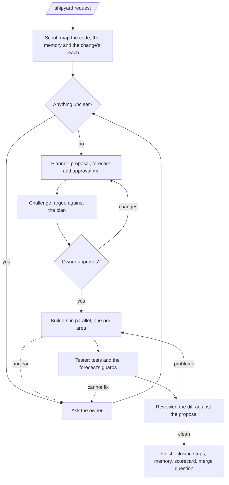
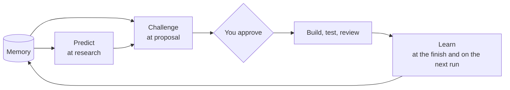

# Shipyard

**A Claude Code plugin that turns a plain-language request into a reviewed, tested branch, with you approving every decision that matters.**

 

Shipyard runs a small crew of specialised agents (scout, planner, builders, tester and reviewer) under one orchestrator. It researches the change, asks when a wrong guess would matter, and presents a proposal you can read on your phone. Only after you approve does it build, test and review, finishing on a pushed branch. It also learns from each run: it remembers your decisions, forecasts what a change could break, challenges its own plans, and measures how well those forecasts hold up.

## Contents

- [Quick start](#quick-start)
- [How a run works](#how-a-run-works)
- [Modes](#modes)
- [Tidy runs](#tidy-runs)
- [Engineering intelligence](#engineering-intelligence)
- [Safety and collaboration](#safety-and-collaboration)
- [Configuration](#configuration)
- [Commands](#commands)
- [Files Shipyard writes](#files-shipyard-writes)
- [Cloud sessions](#cloud-sessions)
- [Development](#development)
- [License](#license)

## Quick start

Install from the terminal, the desktop app or a remote-control session:

```
/plugin marketplace add rafidzane/shipyard
/plugin install shipyard@shipyard
```

Then describe the change:

```
/shipyard add a discount field to the checkout
```

Shipyard sizes the request, researches it, asks any questions that matter, and stops with a proposal for you to approve. Reply to approve it, change it, or ask questions; the run continues from where it stopped, on any device.

## How a run works



| Stage | What happens | Who |
|---|---|---|
| 1. Research | Maps the code the change touches, the project's rules, its memory, and the change's reach and history | Scout |
| 2. Questions | Asks only what would change the outcome; settles the rest and lists it for review | Orchestrator |
| 3. Proposal | Writes `approval.md`: what changes, a wireframe, diagrams, files, acceptance criteria, a forecast of regressions, and the challenges raised against it | Planner, reviewer |
| 4. Approval | Waits for your explicit approval; "looks good, but…" counts as a change request | You |
| 5. Build | Builders work in parallel on areas that share no files | Builders |
| 6. Test | Runs the project's tests and the forecast's guards | Tester |
| 7. Review | Checks the diff against the proposal and the project's rules | Reviewer |
| 8. Finish | Runs the project's closing steps, updates memory and the scorecard, pushes, and asks where to merge | Orchestrator |

Shipyard follows the project's own conventions from `CLAUDE.md` or `AGENTS.md`: its change process (OpenSpec is supported), test commands, version bumps and test-data rules. Where the project is silent, Shipyard's defaults apply.

## Modes

Every run has a mode that sets how much effort each stage gets. Every mode keeps the same safeguards: questions on what matters, no code before approval, and the merge question at the finish.

| Mode | When | What changes |
|---|---|---|
| `quick` | A small, low-risk change: under about 50 lines, at most 3 files, one area | No scout, planner or tester; one builder that also writes the tests; a short proposal |
| `standard` | Everything else | One scout, the full proposal, one builder per area (up to 4), the full test command, one reviewer |
| `deep` | Data-changing migrations, money or calculation logic, sign-in, permissions, security, or more than about 4 areas or 500 lines | Three scouts, a pre-mortem, tests written first, three challengers and three reviewers on Opus |

Shipyard **sizes each request** (files, lines, areas and risk), picks the mode, states the sizing in one line, and re-sizes if research proves the estimate wrong. To choose the mode yourself, prefix the request (`/shipyard quick: …`, `/shipyard deep: …`) or set a project default (see [Configuration](#configuration)). A mode you set is never changed without asking.

## Tidy runs

`/shipyard tidy: remove the dead code in utils/` or `/shipyard tidy, deep: upgrade next to 17` starts a run whose promise is **no behaviour change, with tests green throughout**:

- **Baseline first.** The full test suite runs before anything is proposed; a failing baseline stops the run.
- **Small steps.** One removal, split or upgrade per step, tested as soon as it is done. A step that turns a test red is undone and reported, and the run continues.
- **Tests are the referee.** Existing tests are never weakened or edited, except to delete a test of removed dead code or to apply a mechanical change an upgrade forces.
- **Evidence for every removal**, and the changelog's breaking changes for every upgrade.

Sizing still decides the effort. When a plain request is clearly only cleanup, Shipyard suggests a tidy run.

## Engineering intelligence

Four capabilities form a feedback loop around every run.



### Remember

Each project keeps a memory in `docs/shipyard/memory/`, committed with the runs:

| File | Holds |
|---|---|
| `decisions.md` | Choices you made or approved |
| `incidents.md` | What went wrong, the cause, and the guard against it |
| `patterns.md` | How the project does things |

Every run reads the memory first: settled questions are not asked again, past incidents in the affected files are named, and patterns are treated as project rules. At the finish, the run records what it learned, one entry per line with a stable ID such as `D-7`. You can edit or delete any entry; Shipyard never rewrites an entry you changed, only supersedes it. Credentials and personal data are never recorded.

### Predict

Before you approve, `approval.md` forecasts what the change could break beyond the files it edits:

- **Reach:** the files that depend on the ones being changed, and the screens, endpoints and data they lead to
- **Regressions:** up to six, rated low, medium or high, each backed by evidence (a dependent, a frequently fixed file, a past incident, an untested path), and each medium or high risk paired with a check the run will carry out

The tester performs those checks, and the run records each prediction as held, caught or missed.

### Challenge

Every plan is challenged before you see it. Reviewing the plan against the code, the memory and the forecast, the reviewer asks:

| Question | Asks |
|---|---|
| Simpler | Is there a simpler design that meets every acceptance criterion? |
| Fit | Does it follow the project's existing patterns? |
| History | Does it repeat a rejected design, or skip a past incident's guard? |
| Blast radius | Could it reach less of the system? |
| Regret | What is the owner most likely to regret in six months? |

A challenge needs evidence. The planner must revise the plan or justify it, and anything unresolved comes to you as a question. `approval.md` lists every challenge with its answer, and the approval summary states what the challenge changed.

### Learn

At the finish, the run scores its predictions; a missed problem becomes an incident that names the evidence that would have predicted it. The next run in the project checks how earlier runs held up after merge: a revert or a fix on the same lines counts as a miss. Each run adds a row to `docs/shipyard/memory/scorecard.md`, which tracks, over the last 20 runs, the **forecast hit rate**, **sizing accuracy** and **challenge yield**. These numbers adjust future runs: sizing steps up where changes keep proving larger, repeatedly missed incidents are always forecast, and challenge stances that never help are dropped.

## Safety and collaboration

- **Nothing is built before approval.** Only an explicit approval from you counts.
- **Each run works in its own git worktree** (`<repo>.shipyard/<slug>`), so your branch, uncommitted work and dev servers are untouched by the run, and other sessions sharing your checkout are not disturbed.
- **Agents clean up after themselves.** They stop only processes they started, never stash, reset or switch your branches, and remove temporary files and test data.
- **The run's state lives in the repository** (`state.md`, `tasks.md` and `approval.md`), so a run started on a laptop can continue in a cloud session or on a phone.
- **Merging is always your decision.** At the finish Shipyard asks whether to merge into the branch you started from, `main`, another branch, or not at all. To grant permission in advance, use `/shipyard merge to main: …`; the merge then happens only if tests pass and the review is clean.
- **Parallel runs do not collide.** In projects that number their changes (`NNN-name`), each run reserves its number across all branches.
- **Interfaces stay consistent.** Changes to screens reuse the app's own tokens, components and nearest screen; design skills are used for craft, not for a new look unless you ask for one.
- **Knowledge graphs are used when present.** With `graphify-out/graph.json` in the repository, the scout maps the change through the graph, and the finish updates it.

## Configuration

Shipyard reads these optional lines from the project's `CLAUDE.md` or `AGENTS.md`:

| Line | Effect |
|---|---|
| `Shipyard mode: quick` (or `standard`, `deep`) | Sets the default mode instead of sizing each request |
| `Shipyard worktree: no` | Works in the checkout itself instead of a separate worktree |
| `Shipyard memory: off` | Turns off memory, forecasting feedback and the scorecard |

Request prefixes can be combined, for example `/shipyard tidy, deep, merge to main: …`.

## Commands

| Command | Purpose |
|---|---|
| `/shipyard <request>` | Start a run, or answer, approve or continue the open one |
| `/shipyard:scorecard` | Show the project's forecast hit rate, sizing accuracy, challenge yield, recent runs and incidents |
| `/shipyard:version` | Show the installed version |

## Files Shipyard writes

| Path | Contents |
|---|---|
| `docs/shipyard/<slug>/` (or the project's change folder, such as `openspec/changes/<name>/`) | `state.md`, `scout.md`, `approval.md`, `tasks.md` for each run |
| `docs/shipyard/memory/` | `decisions.md`, `incidents.md`, `patterns.md`, `scorecard.md` |
| Branch `shipyard/<slug>` | The run's commits, one per stage |

## Cloud sessions

Cloud sessions (Claude Code on the web and in the mobile app) do not load locally installed plugins. To make Shipyard available there, commit this hook to the project's `.claude/settings.json`. It installs Shipyard when a cloud session starts and does nothing on your own machine:

```json
{
  "hooks": {
    "SessionStart": [
      { "hooks": [ { "type": "command", "command": "case $CLAUDE_CODE_REMOTE in true) claude plugin marketplace add rafidzane/shipyard >&2; claude plugin install shipyard@shipyard --scope user >&2;; esac; exit 0" } ] }
    ]
  }
}
```

> **Status:** not yet verified in a live cloud session. If it does not work, the fallback is to copy Shipyard into the project's `.claude/` folder.

## Development

| Path | Contents |
|---|---|
| `skills/shipyard/` | The orchestrator (`SKILL.md`) and the templates for `state.md`, `approval.md` and the memory |
| `agents/` | The scout, planner, builder, tester and reviewer |
| `commands/` | `/shipyard:scorecard` and `/shipyard:version` |
| `tests/` | Fast text checks of the skill and agents |
| `evals/` | Behavioural evaluations, each with a scaffolded project and graders |
| `docs/specs/`, `docs/plans/` | The design and the implementation plans |

```bash
bash tests/check-skill.sh && bash tests/check-agents.sh && bash tests/check-bootstrap.sh
claude plugin validate --strict .
claude plugin eval . --ablation none --scaffold --allow-tools Bash Write Edit --trust-plugin --judge-model sonnet
```

Use `--case '<glob>'` and `--runs <n>` to run a subset of the evaluations.

## License

MIT © Rafid Zane
