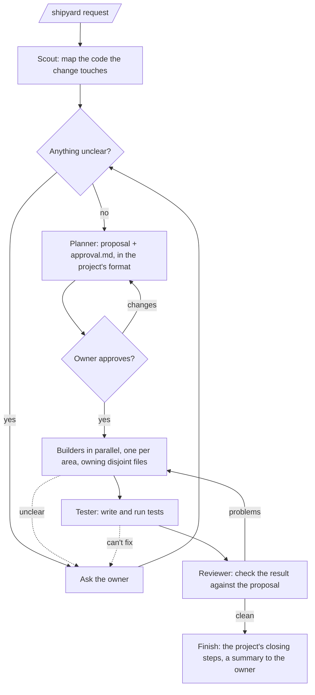

# Shipyard

A Claude Code plugin that turns a plain-words request into a pushed branch. A small crew of agents does the work; you make the decisions.

- It **asks instead of guessing** whenever a wrong guess would change what gets built.
- It writes **`approval.md`** (a wireframe, a diagram of the parts involved and the crew's workflow) and builds nothing until you approve it.
- It **follows your project's own rules** from `CLAUDE.md` / `AGENTS.md`: its process, test commands, version bumps, test-data rules.
- It **finishes on a pushed branch**, `shipyard/<slug>`, then asks whether to merge and push: into the branch you started from, `main`, another branch, or not at all. It never merges without your answer, or your permission given up front: `/shipyard merge to main: …` merges when the run is clean (tests passed, review clean) and asks otherwise.
- It has **three modes**: `/shipyard quick: …` for small changes, plain `/shipyard …` (standard), and `/shipyard deep: …` for risky ones (three scouts, a pre-mortem, tests first, three reviewers). Set a project's default with a `Shipyard mode: <mode>` line in its `CLAUDE.md`. Without either, Shipyard **sizes the change** first (files, lines, areas and risk) and picks the mode and how to run it: a small, safe change runs `quick` (no scout, planner or tester, just the orchestrator and one builder that writes its own tests); anything touching a data-changing migration, money or calculation logic, sign-in, permissions or security runs `deep`; the rest runs `standard`, with one builder per area (at most 4). It says the sizing in one line, re-sizes if research proves it wrong, and never overrides a mode you set. Force a mode with `quick:`, `standard:` or `deep:`.
- It has **tidy runs** for cleanup: `/shipyard tidy: remove the dead code in utils/` or `/shipyard tidy, deep: upgrade next to 17`. A tidy run changes no behaviour, and its tests stay green throughout. It runs the full tests first and won't start on a red baseline. It works in small steps, testing after each, and undoes any step that turns a test red, then carries on and lists the skipped steps. Each removal comes with evidence that the code is dead. It never weakens or edits a test except where an upgrade forces it. The approval is a short list, with no diagrams. Sizing still picks the effort, and Shipyard suggests tidy when a plain request is clearly only cleanup.
- **Each run works in its own git worktree** (`<repo>.shipyard/<slug>` beside the repo), so other sessions sharing your checkout are never disturbed: your branch, your uncommitted work and your dev servers stay as they are, and merging happens from the worktree. Agents stop only processes they started, never stash, reset or switch branches, and clean up what they made. Turn worktrees off with `Shipyard worktree: no` in `CLAUDE.md`.
- **Parallel runs don't collide on change numbers:** a project that numbers its changes (`NNN-name`) gets its number reserved at the start, checked against every branch.
- **`/shipyard:version`** shows which version is installed and loaded in the session.
- It **uses the project's knowledge graph** when there is one: with `graphify-out/graph.json` in the repo, the scout maps the change with graphify first, and the finish runs `graphify update .`.
- **Screen work keeps the UI consistent:** when a change touches a page, a component or an email, the planner, the UI builders and the reviewer copy the app's own tokens, components and nearest screen first, then use `frontend-design` and `design-taste-frontend` for craft (hierarchy, spacing, states, contrast), not for a new look unless the owner asks for one. The reviewer flags one-off styles. A stale design document is reported, and the code wins.

## The run



## Memory

Each project keeps a memory in `docs/shipyard/memory/`, committed with the runs:
- **`decisions.md`:** choices you made or approved
- **`incidents.md`:** what went wrong, why, and the guard against it
- **`patterns.md`:** how this project does things

Every run reads it first. A question you already answered isn't asked again, a past incident in the files being changed is named, and the patterns count as project rules. At the finish, the run adds what it learned, one line per entry, with an ID like `D-7` and the run's name. Edit or delete any entry: Shipyard never rewrites one you changed, it only supersedes it. Nothing secret or personal goes in. Turn it off with a `Shipyard memory: off` line in the project's `CLAUDE.md`.

## Forecast

Before you approve, `approval.md` says what the change is likely to break, beyond the files it edits (`## Impact and regressions`):
- **Reach:** how many files use the ones being changed, and which screens, endpoints or data they lead to
- **Regressions:** up to six, each rated low, medium or high, each with its evidence (a caller, a file that often needs fixes, a past incident, an untested path) and, when medium or high, the check the run will do

The tester carries out those checks, and the run records each prediction as held, caught or missed.

## Challenge

Every plan is argued with before you see it. The reviewer reads the plan against the code, the memory and the forecast, and asks:
- **Simpler:** is there a simpler way?
- **Fit:** does it fit the project's patterns?
- **History:** does it repeat something you already turned down, or skip a past incident's guard?
- **Blast radius:** can it reach less?
- **Regret:** what will you regret?

Each challenge needs evidence. The planner must change the plan or say why not, and an unresolved challenge comes to you as a question. `approval.md` lists every challenge with its answer under `## Challenged`, and the approval summary says what the challenge changed. `quick` asks only "is there something simpler?"; `deep` runs three challengers at once.

## Install (terminal, desktop, remote control)

```
/plugin marketplace add rafidzane/shipyard
/plugin install shipyard@shipyard
```

## Use

```
/shipyard add a discount field to the checkout
```

The run's state lives in the repo (`state.md` and `tasks.md` next to the proposal), so you can start on your laptop and carry on from a cloud session or your phone.

## Cloud sessions (web and mobile)

Cloud sessions (claude.ai/code on the web and the Claude mobile app) don't load installed plugins. To have Shipyard there, commit this hook to the project's `.claude/settings.json`. When a cloud session starts, the hook installs Shipyard; on your own machine it does nothing.

```json
{
  "hooks": {
    "SessionStart": [
      { "hooks": [ { "type": "command", "command": "case $CLAUDE_CODE_REMOTE in true) claude plugin marketplace add rafidzane/shipyard >&2; claude plugin install shipyard@shipyard --scope user >&2;; esac; exit 0" } ] }
    ]
  }
}
```

_Status: not yet proven in a real cloud session. If it doesn't work, this section will describe copying Shipyard into the project's `.claude/` folder instead._
