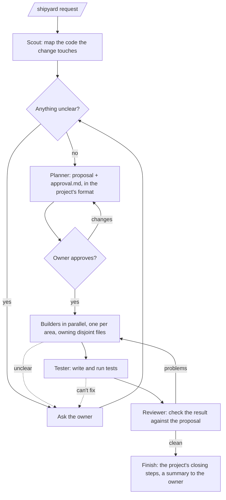

# Shipyard

A Claude Code plugin that turns a plain-words request into a pushed branch. A small crew of agents does the work; you make the decisions.

- It **asks instead of guessing** whenever a wrong guess would change what gets built.
- It writes **`approval.md`** (a wireframe, a diagram of the parts involved and the crew's workflow) and builds nothing until you approve it.
- It **follows your project's own rules** from `CLAUDE.md` / `AGENTS.md`: its process, test commands, version bumps, test-data rules.
- It **finishes on a pushed branch**, `shipyard/<slug>`. You open the pull request; Shipyard never merges.

## The run



## Install (terminal, desktop, remote control)

```
/plugin marketplace add rafidzane/shipyard
/plugin install shipyard@shipyard
```

## Use

```
/shipyard add a discount field to the checkout
```

The run's state lives in the repo (`state.md` and `tasks.md` next to the proposal), so you can start on your laptop and carry on from a cloud session or your phone.

## Cloud sessions (web and mobile)

Cloud sessions (claude.ai/code on the web and the Claude mobile app) don't load installed plugins. To have Shipyard there, commit this hook to the project's `.claude/settings.json`. When a cloud session starts, the hook installs Shipyard; on your own machine it does nothing.

```json
{
  "hooks": {
    "SessionStart": [
      { "hooks": [ { "type": "command", "command": "case $CLAUDE_CODE_REMOTE in true) claude plugin marketplace add rafidzane/shipyard >&2; claude plugin install shipyard@shipyard --scope user >&2;; esac; exit 0" } ] }
    ]
  }
}
```

_Status: not yet proven in a real cloud session. If it doesn't work, this section will describe copying Shipyard into the project's `.claude/` folder instead._
