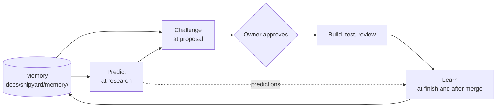

# Shipyard Engineering Intelligence: the four plans

**Goal:** make Shipyard reason about engineering decisions before, during and after a run, not just carry one out. The four capabilities build on each other, so the plans ship in order:

| Plan | Version | Adds | Needs |
|---|---|---|---|
| [Remember](2026-10-19-01-remember.md) | 0.7.0 | A per-project memory of decisions, incidents and patterns, read at the start of every run and written at the finish | none |
| [Predict](2026-10-19-02-predict.md) | 0.8.0 | A forecast of each change's impact and likely regressions, in `approval.md`, from the graph, the diff's reach and the memory | Remember |
| [Challenge](2026-10-19-03-challenge.md) | 0.9.0 | An adversarial pass on the plan before the owner sees it: the reviewer in a "challenge" stance, not a new agent | Remember, Predict |
| [Learn](2026-10-19-04-learn.md) | 1.0.0 | At the finish and after merge, predicted risks compared with what happened, written back to memory, with the forecast's hit rate kept per project | all three |

## Why this, and not another agent

Today every run starts from nothing: the scout re-discovers the project, the planner can repeat a design the owner already turned down, and a bug fixed last week can come back in the same file. These plans add no new crew member and no new command. They make the existing stages smarter by giving them a record to read and a loop to close.

## Constraints all four share

- **Plain files in the project's repo.** The memory is Markdown under `docs/shipyard/memory/`, committed with the run, so any device and any session sees it, and the owner can read and edit it on GitHub's mobile app. No database, no service, no new dependency.
- **The owner is in charge of the record.** Every memory entry names the run it came from. The owner can edit or delete any entry. Shipyard never rewrites an entry the owner edited; it adds a new one that supersedes it.
- **Small and bounded.** Each memory file has a size cap (below), and the oldest or least-used entries are summarised, never silently dropped. Reading the memory must cost a run a few thousand tokens at most.
- **Nothing secret.** No credentials, personal data, customer names or test account passwords in memory. The reviewer checks the memory diff like code.
- **Every mode keeps it, scaled.** `quick` reads the memory and writes one line; `standard` does the full loop; `deep` adds the challenge's third stance and the Learn follow-up after merge.
- **Opt out per project.** `Shipyard memory: off` in the project's `CLAUDE.md` or `AGENTS.md` turns all four off; the runs behave as 0.6.0.
- **Measured.** Each plan adds text checks to `tests/check-skill.sh` and two or more eval cases. Evals grade from files and the final message, not long traces (trace-focused graders proved flaky on long runs in 0.6.0).

## Open decisions for the owner

These are settled in the plans as defaults; change them before building if you disagree.

1. **Where the memory lives:** in the project repo (`docs/shipyard/memory/`, the default, shared and versioned) or in the user's home (private, per machine).
2. **Who may write it:** only the orchestrator at the finish (the default), or any agent during the run.
3. **Learn after merge:** a follow-up check on the next run in the project (the default, no scheduler needed), or a scheduled task that checks a week later.
