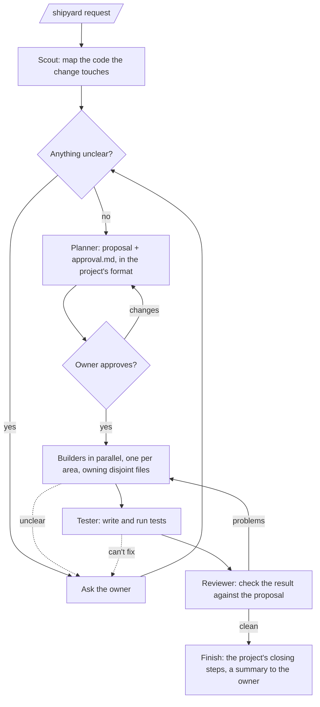

# Shipyard: design

*2026-10-17. Owner: Rafid Zane. Repo: `github.com/rafidzane/shipyard` (public).*

## Intent

A Claude Code plugin that turns a plain-words feature request into shipped code by coordinating a small crew of agents. It does this without guessing on anything that matters, and nothing is built until the owner has approved a visual proposal. It must work in any project, and from the terminal, the web (claude.ai/code) and the Claude mobile app.

Why: the owner already runs a spec-first process by hand in Leisuremint (OpenSpec, version bumps, test-account rules). Shipyard makes that the default flow, with the agents doing the legwork and the owner making the decisions.

## Goals

- One command: `/shipyard <what to build>` starts a run.
- **Ask at any unclear point.** Every stage stops and asks when a wrong guess would change what gets built: where something goes, how a number is calculated, a schema change, scope. The rule is "ask instead of guess" at every stage, not only at fixed checkpoints.
- **Visual approval before code.** When nothing is unclear any more, it writes a proposal plus `approval.md` containing:
  - a picture of the change: a text wireframe of any UI that changes
  - a diagram of the parts involved (Mermaid flowchart: UI → API → service → data)
  - the crew's workflow: which agent does what, in what order and what runs in parallel (Mermaid)
  - files to be touched, risks, and decisions already made

  No production code is written until the owner says it is approved.
- **Follows the project's own rules.** At the start of a run it reads `CLAUDE.md` / `AGENTS.md` and the repo layout, and adopts the project's process.
  - Leisuremint: OpenSpec propose → apply → `./scripts/bump-version.sh` → archive; tick `tasks.md`; test accounts on `@example.com`, cleaned up; the owner's go-ahead before a data-rewriting migration.
  - A project with no stated process gets the default: `docs/shipyard/<slug>/` with `proposal.md`, `approval.md` and `tasks.md`.
- **Works across devices.** On the CLI, in a remote-control session viewed from the phone, and in cloud sessions on web and mobile.
- **Resumable.** A run's state lives in the repo, not in machine-local memory, so a run started on the laptop can be continued from a cloud session.

## Non-goals

- Fully autonomous, unattended runs. The owner is always the approval point.
- A GUI or dashboard. Progress is the chat plus the files in the repo.
- Replacing the project's own tooling (OpenSpec, test runners, version scripts). Shipyard calls them.

## Anti-goals (a failure even if it "works")

- It guesses on something ambiguous and builds the wrong thing.
- It writes production code before approval.
- It breaks a project rule written in `CLAUDE.md`.
- It leaves test data, test users or stray branches behind.
- Two builders edit the same file.
- It is so heavy that a small change takes longer than doing it by hand. The crew scales down: a one-file change gets one builder and no parallel step.

## The run

- **Orchestrator:** the `/shipyard` skill itself, running in the main session. Subagents cannot start other subagents, so coordination has to happen there. It owns all questions to the owner and all approvals.
- **Scout** (read-only subagent, cheap model): finds the files, patterns and project rules relevant to the request.
- **Planner** (subagent): writes the proposal and `approval.md` in the project's format.
- **Builder** (subagent, started once per area): implements only the files it was assigned. It stops and reports back rather than guessing.
- **Tester** (subagent): writes tests for the proposal's acceptance criteria, runs the project's test commands, and reports pass/fail with output.
- **Reviewer** (read-only subagent): compares the diff to the proposal and the project rules, and reports problems ranked by severity.

## Constraints

- Standard Claude Code plugin layout: `.claude-plugin/plugin.json` plus `skills/`, `agents/` and `commands/`. The repo is also its own marketplace (`.claude-plugin/marketplace.json`), so installing it is `/plugin marketplace add rafidzane/shipyard` followed by `/plugin install shipyard@shipyard`.
- **Cloud sessions do not load plugins**, whether installed by the user or enabled in the repo's `.claude/settings.json` (per Claude Code docs, cloud-environments page). So:
  - First try a committed `SessionStart` hook that installs Shipyard from GitHub when a cloud session starts. This is undocumented, so prove it with a spike first.
  - If the spike fails, use `/shipyard:install`, which copies the skill and agents into the project's `.claude/skills/` and `.claude/agents/` for the owner to commit. That route is documented to work.
- **Self-contained.** No dependency on superpowers or any other plugin, because cloud sessions won't have them. *(Builder's call: this is my decision, not the owner's.)*
- Machine-local auto memory does not reach cloud sessions, so run state lives in the repo:
  - in `tasks.md` checkboxes
  - in a short `state.md` next to the proposal: stage, approval status, open questions
- Phone approval:
  - `approval.md` uses only Mermaid and fenced text, which GitHub's app renders.
  - When the session can publish an artifact (CLI, desktop, remote control), the orchestrator also offers it as a page.
  - In cloud sessions the work is already on a pushed branch. Locally, it asks before pushing.
- Questions use the `AskUserQuestion` tool, which also shows up in remote-control and cloud sessions on the phone.
- This machine has no `gh` CLI. Nothing in Shipyard may require it.

## Calls made by the designer (owner to check)

- **Recording approval.** The owner approves in chat, either through an `AskUserQuestion` answer or by typing "approved", from any device. The orchestrator then writes `approved: <date>, <what was approved>` into `state.md` and commits it.
  - A resumed session trusts only `state.md`.
  - Builders never start while `state.md` says not approved.
- **Branches and commits.**
  - One branch per run: `shipyard/<slug>`.
  - Commit at the end of each stage (proposal, approval, build, tests, review), so any device can resume.
  - Locally, ask once per run, at approval, before pushing. In cloud sessions the branch is pushed anyway.
- **Builders' working tree.** Builders share one working tree, each owning disjoint files. No worktrees, so nothing needs merging.
- **Adopting the project's process.**
  - The orchestrator (main session) runs the project's own commands itself, for example `/opsx:propose` through the Skill tool, and then has the Planner add `approval.md`.
  - Builders do the work that `/opsx:apply` would do and tick `tasks.md`.
  - `approval.md` and `state.md` go in the project's change folder when there is one (`openspec/changes/<name>/`), otherwise in `docs/shipyard/<slug>/`.

## Decided by the owner

- Name **shipyard**, a public GitHub repo, usable in any project.
- Ask at any ambiguous point. Make the proposal with a picture, a diagram and the workflow, for approval.
- Approval page format: Markdown or HTML in the repo (Markdown with Mermaid chosen, so it renders on GitHub mobile).
- Must work on web and mobile.
- **Finished means a pushed branch.** The run ends with its `shipyard/<slug>` branch pushed to GitHub. The owner opens the pull request or merges it; Shipyard never merges to main.
- **Fresh approval only for real scope changes.** After approval, if the plan gains or loses a goal, a screen or a database change, the orchestrator updates `approval.md`, sets `state.md` back to not approved and asks again. Smaller adjustments are listed in the final summary.

## Left to the builder

- Exact prompts and wording of the agents, and model choice per agent (cheap for read-only).
- How the crew is sized and areas are split for a given request.
- The exact `state.md` format.
- How to test the plugin. At minimum: plugin validation, plus one end-to-end run on a small real change in Leisuremint.
- Whether `/shipyard:install` is needed at all, depending on the spike.
