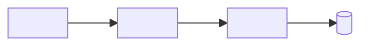
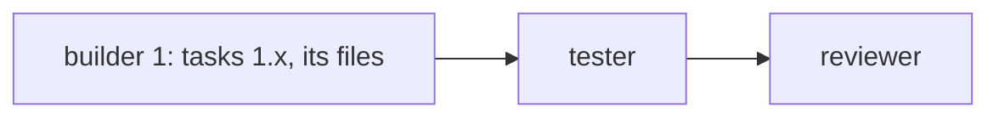

# Approval: <slug>

## What changes
<3 to 6 plain sentences: what the owner will see or get, and what stays the same.>

## Picture
```text
<A text wireframe of each screen, page or output that changes. Write "No screen changes" instead of the block when nothing visible changes.>
```

## How it fits


## Crew workflow

<One builder per area. Areas never share a file. A small change is one builder and no parallel step.>

## Files
- `<path>`: <the change>

## Acceptance criteria
- [ ] <something a person can check, one per line>

## Risks
- <what could go wrong, and how the change guards against it; "None worth noting" when that is true>

## Decisions made
- Owner: <an answer the owner gave>
- Planner: <a call the planner made, for the owner to check>
