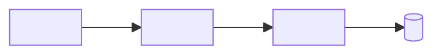
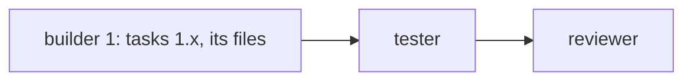

# Approval: <slug>

<!-- quick: only What changes, Picture, Files, Acceptance criteria, Impact and regressions (one line), Decisions made. standard: the eight sections. deep: the eight plus the three at the end.
     tidy (any mode): What changes, Removals and/or Upgrades, Files, Acceptance criteria, Impact and regressions, Decisions made; deep adds Pre-mortem. No Picture, no diagrams. -->

## What changes
<3 to 6 plain sentences: what the owner will see or get, and what stays the same.>

## Removals
<tidy only: one line per thing removed: `path:symbol` — the evidence it is dead (no references in the graph or a repo-wide search of code, strings, config and routes; the dead-code tool's output when the project has one). A public entry point goes under Decisions made as a question, not here.>

## Upgrades
<tidy only: one line per dependency: name from → to, the changelog's breaking changes that touch this code, and the lockfile change.>

## Picture
```text
<A text wireframe of each screen, page or output that changes. Write "No screen changes" instead of the block when nothing visible changes.>
```

## How it fits


## Crew workflow

<One builder per area. Areas never share a file. A small change is one builder and no parallel step.>

## Files
- `<path>`: <the change>

## Acceptance criteria
- [ ] <something a person can check, one per line>
<tidy: always include "the full test command passes, same as the baseline" and "no behaviour change".>

## Impact and regressions
Reach: <N files edited, N that use them, N screens, N endpoints, data written or none>.

| ID | What could regress | Likelihood | Why we think so | Guard |
|---|---|---|---|---|
| R-1 | <what a user would hit> | low, medium or high | <evidence: a dependent, a hot file, an incident ID, an untested path> | <the test, check or screenshot the run will do> |

<At most 6 rows, most likely first. Every row cites evidence. Every medium or high row has a guard the run will actually carry out. quick: one line, "Reach: … Most likely regression: … Guard: …".>

## Risks
- <what could go wrong, and how the change guards against it; "None worth noting" when that is true>

## Decisions made
- Owner: <an answer the owner gave>
- Planner: <a call the planner made, for the owner to check>

## Alternatives considered
<deep only: two or three other ways to build it, and why this one>

## Pre-mortem
<deep only: assume it shipped and failed; the likeliest reasons, each with the guard against it>

## Test plan
<deep only: what will be tested and how, including any browser or end-to-end check>
